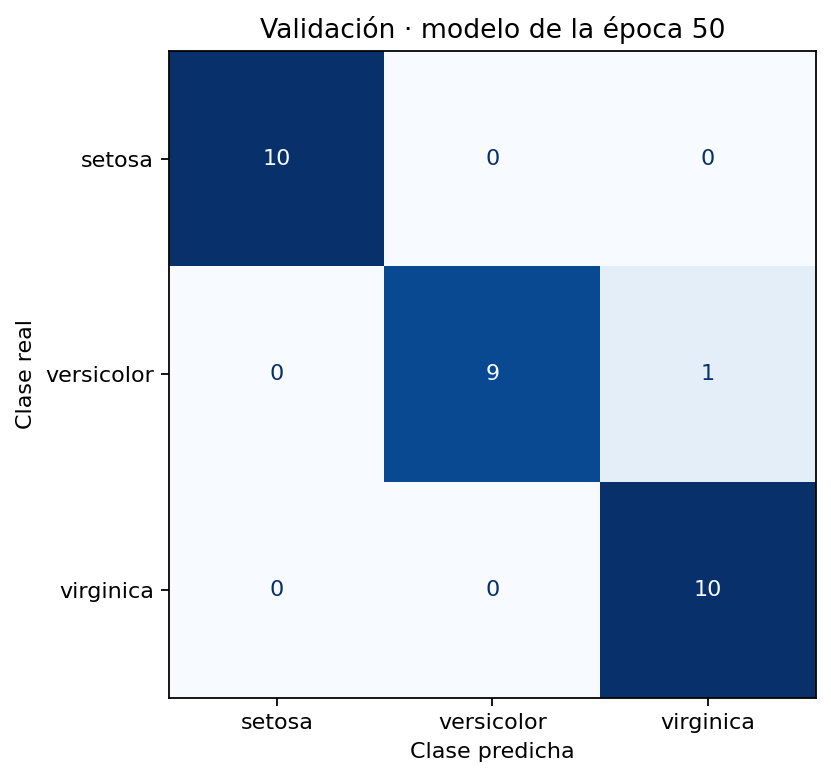

# Pre-entrega 1 - Pipeline base de clasificación con PyTorch
Proyecto integrador · Data Science III 

## Objetivo y datos
Clasificar las tres especies de Iris usando cuatro mediciones, con un MLP 4 → 16 → 16 → 3 y ReLU.
120 ejemplos de entrenamiento y 30 de validación; división estratificada y StandardScaler ajustado solo con entrenamiento.

## Configuración
- Semilla: 42
- Adam, learning_rate: 0.01
- Épocas: 50; batch_size: 16
- Pérdida: CrossEntropyLoss sobre logits, sin Softmax previo.
- Datos: float32; etiquetas: long.

## Resultados reales de esta ejecución
La pérdida antes de entrenar fue 1.0924 en entrenamiento y 1.0948 en validación. En la época 50 fue 0.0239 y 0.1122, respectivamente. La pérdida mínima observada de validación fue 0.0825 en la época 48. Hubo 19 incrementos entre épocas consecutivas de validación (de 49 comparaciones). El accuracy final fue 96.67%, equivalente a 29/30 aciertos. Estas métricas corresponden a una partición pequeña y no prueban ausencia de sobreajuste.

## Validaciones incorporadas
Dimensiones, conjuntos separados, gradientes finitos, actualización de pesos, métricas finitas y evaluación sin cambios en el modelo.
Las métricas de entrenamiento se acumulan durante las actualizaciones; validación se calcula al final de cada época.
No se utiliza un conjunto de test independiente ni se guarda/restaura un modelo de la mejor época.

## Estructura
- data/README.md: descripción del origen de los datos.
- notebooks/01_pipeline_base.ipynb: desarrollo autónomo y comentado.
- reports/: métricas, resumen con configuración e índices y figuras.
- requirements.txt: versiones del entorno verificado.

## Alcance
Pre-entrega técnica: pipeline funcional y comprensible. Las 30 muestras de validación no permiten asegurar rendimiento en producción.
Un checkpoint de pesos es opcional y no forma parte de esta versión.

### Interpretación del experimento:
La pérdida (*loss*) descendió de manera consistente a lo largo de las 50 épocas tanto en el conjunto de entrenamiento como en el de validación. Ambas curvas convergen de forma pareja sin que la pérdida de validación se dispare hacia arriba, lo que demuestra que el clasificador base aprende patrones generalizables y no presenta *overfitting* severo.

# Pre-entrega 3 · Clasificador supervisado de AG News

## Justificación del modelo

El modelo seleccionado fue LinearSVC porque trabaja con matrices TF-IDF dispersas de alta dimensión y permite asignar una categoría por noticia. La elección responde al objetivo de clasificación y a las características de los datos. La comparación experimental se concentró en los parámetros de TF-IDF.

## Análisis preliminar

Se identifican a Business como la categoría con menor F1 (0,8518). El cruce principal fue Sci_Tech → Business, con 45 casos, seguido de Business → Sci_Tech, con 41. Juntas, ambas direcciones explican 86 de los 208 errores (41,3 %). La noticia sobre la oferta de Oracle por PeopleSoft ilustra cómo un mismo texto puede combinar vocabulario tecnológico y financiero.

## Archivo de Requerimientos

El archivo requirements.txt contiene las dependencias de las tres pre-entregas del
curso DataScience 3 - NLP