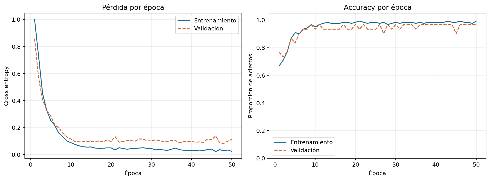

# Pipeline base de clasificación con PyTorch
Proyecto integrador · Data Science III · Módulo 1. Preparado para Hans.

## Objetivo y datos
Clasificar las tres especies de Iris usando cuatro mediciones, con un MLP 4 → 16 → 16 → 3 y ReLU.
120 ejemplos de entrenamiento y 30 de validación; división estratificada y StandardScaler ajustado solo con entrenamiento.

## Instalación y ejecución
Referencia de ejecución: Python 3.12.14, PyTorch 2.15.0+cpu, dispositivo cpu.

1. Descomprimir el proyecto y abrir una terminal en su raíz.
2. Crear entorno: `python -m venv .venv`.
3. Activar en Windows PowerShell: `.venv\Scripts\Activate.ps1`; en macOS/Linux: `source .venv/bin/activate`.
4. Instalar: `python -m pip install -r requirements.txt`.
5. Abrir `notebooks/01_pipeline_base.ipynb` en VS Code con las extensiones Python/Jupyter y seleccionar ese entorno.
6. Reiniciar el kernel y ejecutar todas las celdas. Se regeneran README y reports/.

Para Colab, subir el notebook y ejecutar con sus librerías disponibles; revisar las versiones impresas.
Para usar GPU, instalar previamente la variante de PyTorch compatible desde https://pytorch.org/get-started/locally/.
La detección CUDA/MPS/CPU es automática; este proyecto fue verificado en cpu, no en todos los dispositivos.
Las semillas no garantizan identidad numérica entre hardware y versiones.

## Configuración
- Semilla: 42
- Adam, learning_rate: 0.01
- Épocas: 50; batch_size: 16
- Pérdida: CrossEntropyLoss sobre logits, sin Softmax previo.
- Datos: float32; etiquetas: long.

## Resultados reales de esta ejecución
La pérdida antes de entrenar fue 1.0924 en entrenamiento y 1.0948 en validación. En la época 50 fue 0.0239 y 0.1122, respectivamente. La pérdida mínima observada de validación fue 0.0825 en la época 48. Hubo 19 incrementos entre épocas consecutivas de validación (de 49 comparaciones). El accuracy final fue 96.67%, equivalente a 29/30 aciertos. Estas métricas corresponden a una partición pequeña y no prueban ausencia de sobreajuste.

## Validaciones incorporadas
Dimensiones, conjuntos separados, gradientes finitos, actualización de pesos, métricas finitas y evaluación sin cambios en el modelo.
Las métricas de entrenamiento se acumulan durante las actualizaciones; validación se calcula al final de cada época.
No se utiliza un conjunto de test independiente ni se guarda/restaura un modelo de la mejor época.

## Estructura
- data/README.md: descripción del origen de los datos.
- notebooks/01_pipeline_base.ipynb: desarrollo autónomo y comentado.
- reports/: métricas, resumen con configuración e índices y figuras.
- requirements.txt: versiones del entorno verificado.
- GUIA_ENTREGA.md: instrucciones de versionado y entrega.

## Fuentes
Material adjunto: presentación Módulo 1 Data Science III, diapositivas 30–39, y notebook de clase, Parte 4.
- https://docs.pytorch.org/tutorials/beginner/basics/optimization_tutorial.html
- https://docs.pytorch.org/docs/stable/generated/torch.nn.CrossEntropyLoss.html
- https://scikit-learn.org/stable/modules/generated/sklearn.datasets.load_iris.html
- https://scikit-learn.org/stable/common_pitfalls.html

## Alcance
Pre-entrega técnica: pipeline funcional y comprensible. Las 30 muestras de validación no permiten asegurar rendimiento en producción.
Un checkpoint de pesos es opcional y no forma parte de esta versión.
